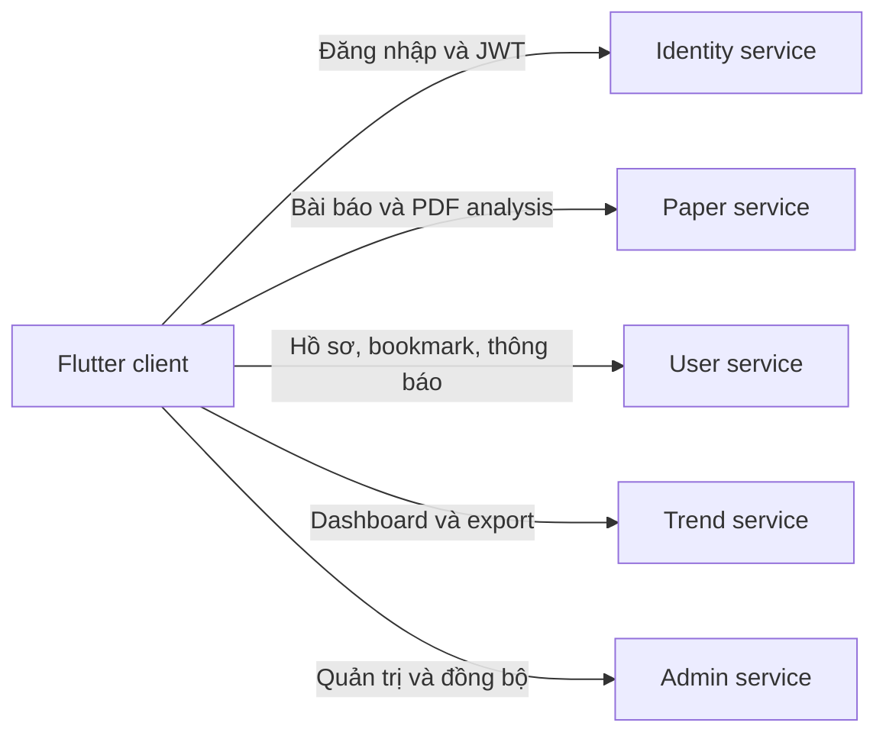

# Journal Trend Tracker Mobile

Ứng dụng Flutter hỗ trợ khám phá, quản lý và phân tích xu hướng bài báo khoa học.

> **Dự án nhóm.** Phần *Đóng góp của tôi* bên dưới chỉ ghi nhận những hạng mục tôi trực tiếp triển khai hoặc bảo trì; lịch sử Git được giữ công khai để đối chiếu.

## Mục tiêu

Journal Trend Tracker giúp người dùng tìm kiếm bài báo khoa học, theo dõi xu hướng nghiên cứu, lưu bài viết, tải PDF để phân tích và xuất báo cáo. Hệ thống có giao diện riêng cho người dùng và quản trị viên.

## Chức năng chính

- Đăng ký, đăng nhập và quản lý phiên bằng JWT
- Tìm kiếm, lọc, xem chi tiết và lưu bài báo
- Tải PDF và phân tích chuyên sâu
- Dashboard xu hướng, biểu đồ và xuất báo cáo
- Quản lý hồ sơ, bookmark và thông báo
- Dashboard quản trị, quản lý người dùng và đồng bộ dữ liệu
- Responsive cho mobile, desktop và web

## Công nghệ sử dụng

| Nhóm | Công nghệ |
|---|---|
| Mobile | Flutter, Dart |
| API | Dio, HTTP, REST API |
| Routing | GoRouter |
| Local storage | SharedPreferences |
| Charts | fl_chart |
| File handling | file_picker, image_picker, path_provider, open_filex |
| CI | GitHub Actions |

## Đóng góp của tôi

- Triển khai Deep Analyze PDF và xử lý lỗi upload PDF trên web.
- Sửa luồng route export để không làm ảnh hưởng tab Papers.
- Sửa lỗi chữ không hiển thị bằng cách thống nhất light theme toàn cục.
- Merge nhánh `dev` vào `main` và xử lý merge conflict.

Các commit tham khảo:

- [Deep Analyze PDF và Web upload](https://github.com/S-bon-debug/journal_trend_tracker_mobile/commit/3a2759e6b9d46214d418c9be64110f6f768192b0)
- [Sửa export routing](https://github.com/S-bon-debug/journal_trend_tracker_mobile/commit/8e9e0aaa8c0fefe99675a734df7070a200559270)
- [Sửa global theme](https://github.com/S-bon-debug/journal_trend_tracker_mobile/commit/b83ee4f3539980626963135d960fe26fd86198fb)

## Khởi chạy local

### Yêu cầu

- Flutter SDK tương thích Dart `^3.10.7`
- Các backend service tương ứng đang hoạt động

### Chạy ứng dụng

```bash
git clone https://github.com/S-bon-debug/journal_trend_tracker_mobile.git
cd journal_trend_tracker_mobile
flutter pub get
flutter run
```

## Kiểm tra chất lượng

```bash
dart format --output=none --set-exit-if-changed .
flutter analyze
flutter test
flutter build apk --debug
```

## Cấu trúc mã nguồn

```text
lib/
  core/        # network, routing, storage, theme
  features/    # admin, paper, trend, auth, profile, notifications
  main.dart
```

## Kiến trúc tổng quan



Ứng dụng giữ cấu hình API tại `lib/core/network/api_config.dart`. Để chạy đầy đủ local, tất cả backend service phụ thuộc cần hoạt động.

## Tài liệu liên quan

- [Phân công module Flutter](task_assignment_mobile.md)

## Ghi chú dự án nhóm

Repository có nhiều thành viên đóng góp. Tôi không nhận phần việc của các thành viên khác; vui lòng xem Git history để biết chi tiết từng thay đổi.
